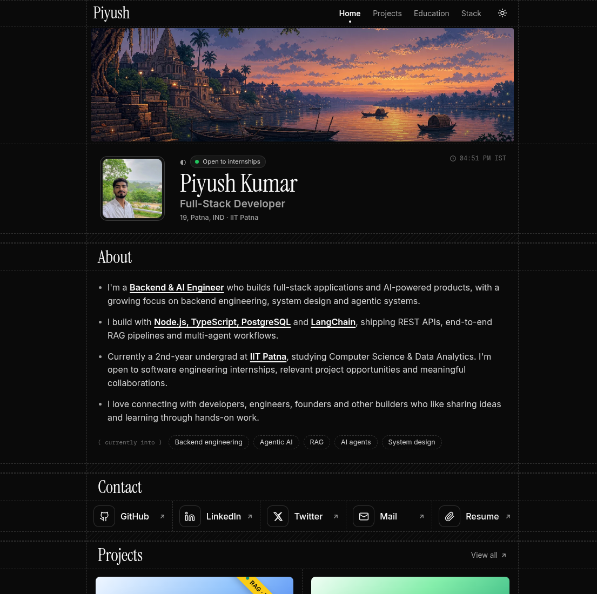
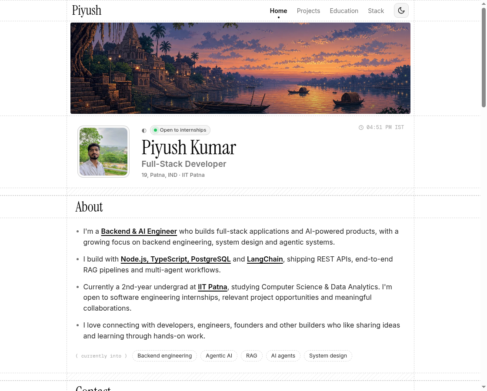
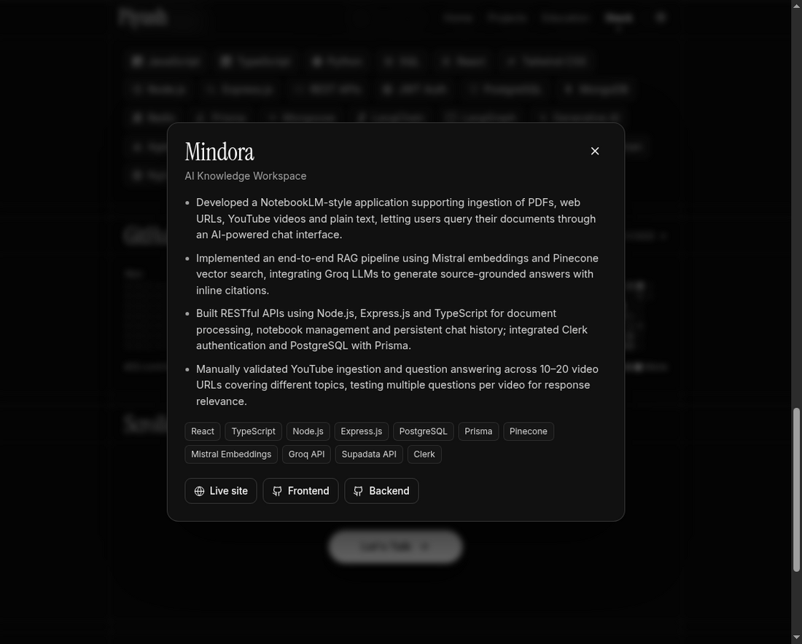

<div align="center">

# Piyush Kumar · Portfolio

**Backend & AI Engineer · IIT Patna**

I build full-stack applications and AI-powered products, with a focus on backend engineering, system design and agentic systems.

[](https://github.com/piyush00868)
[](https://www.linkedin.com/in/piyush-kumar-7a594227a/)
[](https://x.com/piyushkumarr_)
[](mailto:piyushkumar52679@gmail.com)

</div>

<br />



## About

This is my personal portfolio. It's a single-page site with a dark, minimal look, built with plain HTML, CSS and JavaScript. There's no framework and no build step.

I'm a 2nd-year undergrad at **IIT Patna** (BS in Computer Science & Data Analytics). I'm open to **software engineering internships**, project opportunities and collaborations.

## Features

- **Dark and light themes.** Dark by default. The toggle switches themes with a circular reveal animation and remembers the visitor's choice.
- **Animated hero.** Pixel-art banner, an "open to internships" status badge, a role line that cycles through titles, and a live IST clock.
- **Project cards with details.** Click a card to open a popup with the full write-up, tech used, and live and repo links.
- **Filterable tech stack.** Brand logos, with filters for Languages, Frontend, Backend, Databases, AI and Tools.
- **Live GitHub activity.** The contribution graph is fetched live, so it's always current.
- **Scroll reveal and active nav.** Sections fade in as you scroll and the navbar highlights where you are.
- **Responsive.** Works on phones, tablets and desktops.
- **Fast.** One HTML file plus a few images, with no JS framework to download.

## Projects featured

| Project | What it is | Tech | Links |
|---|---|---|---|
| **Mindora** | AI knowledge workspace (NotebookLM-style). Chat with PDFs, URLs, YouTube videos and text, with cited answers through a RAG pipeline. | React, TypeScript, Node.js, Express, PostgreSQL, Prisma, Pinecone, Mistral, Groq | [Live](https://www.mindor.me/) · [Frontend](https://github.com/piyush00868/notebook-llm-frontend) · [Backend](https://github.com/piyush00868/notebook-llm-backend) |
| **Multi-Agent Research System** | 4-stage LangChain pipeline (search → reader → writer → critic) that turns a topic into a sourced report and scores it out of 10. | Python, LangChain, Groq, Tavily, Streamlit | [GitHub](https://github.com/piyush00868/Multi-Agent-AI-Research-System) |
| **EventEra** | Full-stack event booking platform with OTP-verified accounts, role-based access, seat tracking and an admin dashboard. | React, Node.js, Express, MongoDB, JWT, Nodemailer | [GitHub](https://github.com/piyush00868/EventPlatform) |

## Screenshots

<table>
  <tr>
    <td></td>
    <td></td>
  </tr>
  <tr>
    <td align="center"><sub>Light theme</sub></td>
    <td align="center"><sub>Project details popup</sub></td>
  </tr>
</table>

## Built with

- **HTML, CSS and vanilla JavaScript**, with no frameworks or dependencies
- **Fonts:** [Instrument Serif](https://fonts.google.com/specimen/Instrument+Serif) (headings), [Inter](https://fonts.google.com/specimen/Inter) (body), [Geist Mono](https://fonts.google.com/specimen/Geist+Mono) (labels)
- **Icons:** [Simple Icons](https://simpleicons.org/) for tech logos, plus inline SVGs
- **APIs:** the browser's View Transitions API (theme switch) and IntersectionObserver (scroll effects)
- **Data:** [github-contributions-api](https://github.com/grubersjoe/github-contributions-api) for the activity graph
- **Hosting:** ready for [Vercel](https://vercel.com), using one serverless function

## Getting started

You need **Node.js 20+**.

```bash
git clone https://github.com/piyush00868/portfolio.git
cd portfolio
npm run dev
```

Then open **http://localhost:3000**. There's nothing to install because the project has no dependencies.

## Deploy

**Vercel (recommended):**

1. Go to [vercel.com/new](https://vercel.com/new) and import this repo.
2. Click **Deploy**. You don't need to change any settings.

`public/` is served as the site, and `api/contributions.js` runs as a serverless function for the GitHub graph.

**Other hosts (Netlify, GitHub Pages and so on):** you can deploy the `public/` folder on its own. The site still works, but the GitHub graph will show a link to my profile instead.

## Project structure

```
portfolio/
├── public/
│   ├── index.html          # the whole site (HTML, styles and scripts inline)
│   ├── resume.pdf          # opened by the Resume tile
│   └── assets/
│       ├── avatar.webp     # profile photo
│       ├── banner.webp     # pixel-art hero banner
│       ├── favicon.png
│       └── mindora.webp    # Mindora project cover
├── api/
│   └── contributions.js    # GitHub contributions proxy (Vercel function)
├── server.js               # local dev server
├── vercel.json
└── package.json
```

## Customizing

Everything is in `public/index.html`:

- **Colors:** edit the CSS variables under `[data-theme="dark"]` and `[data-theme="light"]` at the top of the `<style>` block.
- **Projects:** edit the `<article class="proj">` cards for the grid, and the `P` object in the script for the detail popups.
- **Tech stack:** edit the `STACK` array in the script. Each entry is `[label, simple-icons-slug, category]`.
- **Rotating roles:** edit the `roles` array.
- **GitHub username:** change `piyush00868` in `api/contributions.js`.

## Contact

Open to internships, project opportunities and collaborations. Feel free to reach out.

- **Email:** [piyushkumar52679@gmail.com](mailto:piyushkumar52679@gmail.com)
- **LinkedIn:** [piyush-kumar-7a594227a](https://www.linkedin.com/in/piyush-kumar-7a594227a/)
- **X / Twitter:** [@piyushkumarr_](https://x.com/piyushkumarr_)
- **GitHub:** [@piyush00868](https://github.com/piyush00868)

<div align="center">
<br />
<sub>Designed &amp; developed by <b>Piyush Kumar</b></sub>
</div>
